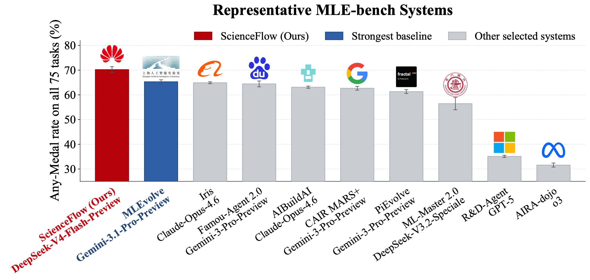
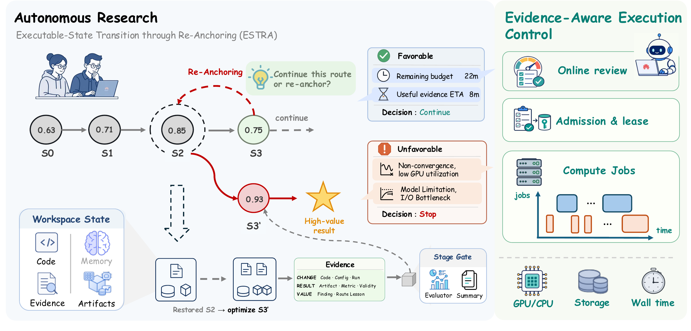

<h1 align="center">ScienceFlow</h1>

<p align="center"><b>端到端自动研究 Agent 框架</b></p>

<p align="center">
  <a href="https://www.noahlab.com.hk/news/212"><b>项目报道</b></a>
  ·
  <a href="https://arxiv.org/abs/2608.14354"><b>arXiv 论文</b></a>
  ·
  <a href="../../README.md"><b>English</b></a>
</p>

> [!IMPORTANT]
> **测试预览版 · 0.2.0b11。**
> 稳定版发布前，接口和工作区元数据仍可能调整。

ScienceFlow 是一个端到端自动研究 Agent 框架，面向持续数小时或数天的高效、稳定且目标一致的研究过程。它以可恢复的可执行工作空间为核心，将持久状态、自适应探索与证据感知执行控制统一起来，使 Agent 能够在保留已验证进展的同时继续、调整或恢复研究路线。

ScienceFlow 文档使用 **iqcraft** 作为 InquiryCraft 的简称；Python 包、import 与 CLI 示例仍统一使用
正式名称 `inquirycraft`。

ScienceFlow 在机器学习、科学建模和数学优化任务上持续开展长程研究，并在完整 75 题 MLE-bench 上于 24 小时预算内达到 **70.22 ± 1.18% Any-Medal**，超过已报告最强基线 **4.92 个百分点**。

<p align="center">
  
</p>
<p align="center"><sub><b>图 1a：完整 MLE-bench Any-Medal 排行榜。</b> ScienceFlow 结果为三次独立运行的均值 ± SEM。</sub></p>

## 快速开始

**前置要求：** Python 3.11+ 和可用的模型 API。当前 PyPI 包是测试预览版，下面固定
具体版本，避免测试环境随后续 Preview 改变。

### 安装

推荐使用 [`pipx`](https://pipx.pypa.io/latest/how-to/install-pipx.html) 安装。ScienceFlow 的
Python 依赖会保持隔离，同时 `scienceflow` 命令可以在任意目录直接使用：

```bash
pipx install scienceflow==0.2.0b11
scienceflow --help
```

<details>
<summary><strong>其他安装方式</strong></summary>

**Conda**

```bash
conda create -n scienceflow python=3.12 -y
conda activate scienceflow
python -m pip install scienceflow==0.2.0b11
```

**uv**

```bash
uv tool install scienceflow==0.2.0b11
```

**Python 虚拟环境**

```bash
python3 -m venv .venv
source .venv/bin/activate
python -m pip install scienceflow==0.2.0b11
```

</details>

### 配置并启动

首次使用时创建模型注册表，编辑生成的文件，然后启动 TUI：

```bash
scienceflow config init
scienceflow config path
scienceflow tui
```

默认配置位于 `~/.config/scienceflow/models.json`，权限为 `600`；API Key 不会复制到
manifest、session 或报告中。详细字段见[模型配置说明](LLM_CONFIGURATION.md)，也可参考
[脱敏的多端点配置示例](../examples/models.example.json)。工作区和恢复选项可运行
`scienceflow tui --help` 查看。进入 TUI 后，使用 `/long-research` 准备并启动托管研究任务。

## 最新动态

- **[2026-09]** 发布科学家智能体 Harness 预览版，支持 TUI 与 Web 交互。
- **[2026-08]** ScienceFlow 正式开源，包含框架代码、任务包与文档；论文同步上线 [arXiv](https://arxiv.org/abs/2608.14354)。

## 核心概念

1. **可恢复的可执行状态。** 每个持续运行的 LNR worker 在隔离的可执行工作空间中推进研究；归档状态将工作空间与紧凑记忆、验证证据和资源记录绑定在一起。
2. **Stage Gate。** 任务特定的结果信号触发 `GateService`：配置的 Evaluator 生成标准化证据，Gate policy 决定是否准入。通过准入的结果被物化为不可变 Stage，并记录 ledger facts 和可恢复工作空间快照。
3. **ESTRA。** 在研究边界，Executable-State Transition through Re-Anchoring 做一次两轴决策：起点（当前工作区或已归档 Stage）与意图（`continue` 继续或 `redirect` 重定向）。选择归档起点时，系统会在下一研究分段开始前恢复对应的可执行状态。
4. **持久记忆。** Add 记录通过准入的 Stage 进展；Fold 保留 recent、best-validated 和 anchor-relevant 证据，并压缩旧记录；Unfold/restore 检索带索引的证据与状态，Assemble 为下一分段构造与锚点对应的上下文。
5. **证据感知执行控制。** 研究 worker 决定科学路线，控制器依据资源可用性、剩余预算、已验证进展和可恢复性，对物理任务进行准入、资源租约、在线监控、限时与停止；有效 worker 状态最终归档到 `merge/finals/final_*`。

## 系统架构

<p align="center">
  
</p>
<p align="center"><sub><b>图 2：ScienceFlow 系统架构。</b> Research worker 基于可恢复的可执行状态推进研究，通过边界触发的 ESTRA 调整长程轨迹；证据感知执行控制负责协调物理资源分配与任务执行。</sub></p>

## 源码开发

参与源码开发时，从审核过的锁文件创建环境：

```bash
cd ScienceFlow
uv sync --python 3.12 --group dev
uv run scienceflow config init
uv run scienceflow tui
```

默认命令安装 Light 开发环境。只有需要 ML、GPU、MLE-bench 和 scientific-design 依赖时，
才使用 `uv sync --extra full --group dev`。发布包的 Full profile 应在虚拟环境内安装：

```bash
python -m pip install "scienceflow[full]"==0.2.0b11
```

ScienceFlow 在进程内使用 InquiryCraft `0.9.7` 作为通用 Agent Runtime，不需要另起服务。
源码环境与 PyPI 安装使用相同的 CLI 和用户私有模型注册表。

## 文档

[文档索引](../README.md) · [运行指南](RUNTIME_GUIDE.md) · [架构总览](scienceflow/index.html) · [可恢复状态与 LNR](scienceflow/module-lnr.html) · [证据感知执行控制](scienceflow/module-resource.html) · [新增优化任务](scienceflow/module-opt-solver-onboarding.html) · [当前规划](../plans/current/) · [SciModelingBench](../../tasks/sci_modeling_bench/README.md)

机器学习工程、科学建模和数学优化任务共享同一套 Stage Gate 与 Evaluator contract。
配置字段、仓库职责边界、任务 contract 和 Benchmark 细节统一放在上述文档中，不在 README
重复展开。

## 运行注意

- MLE-bench 任务需要数据根、任务 `exp_id`、`submission.csv` contract 对齐。
- 不同任务 profile 的旧 workspace 不应混用 resume，否则可能继承错误 prompt、dataset 或 artifact 维度。
- `stopped_by_user` 表示人为停止的可恢复终态，不等价于失败；后续 resume 应从 `state.json` 的累计预算和 workspace stage 继续。
- 使用 `/tasks` 查看任务，`/status N` 查看任务结果、模型用量和资源情况。

## 验证

```bash
.venv/bin/pytest -q \
  tests/test_inquirycraft_dependency_boundary.py \
  tests/test_inquirycraft_cli_composition.py \
  tests/test_long_research_interaction.py
```

发布 workflow 仅接受与项目版本一致的 tag；它会构建并检查 wheel 与源码包，在干净环境中
安装 wheel，运行公共依赖契约，再通过 PyPI Trusted Publishing 上传。完整回归命令为
`uv run --locked pytest -q`。ML、GPU、MLE-bench 与 scientific-design 测试需要对应的可选依赖。
